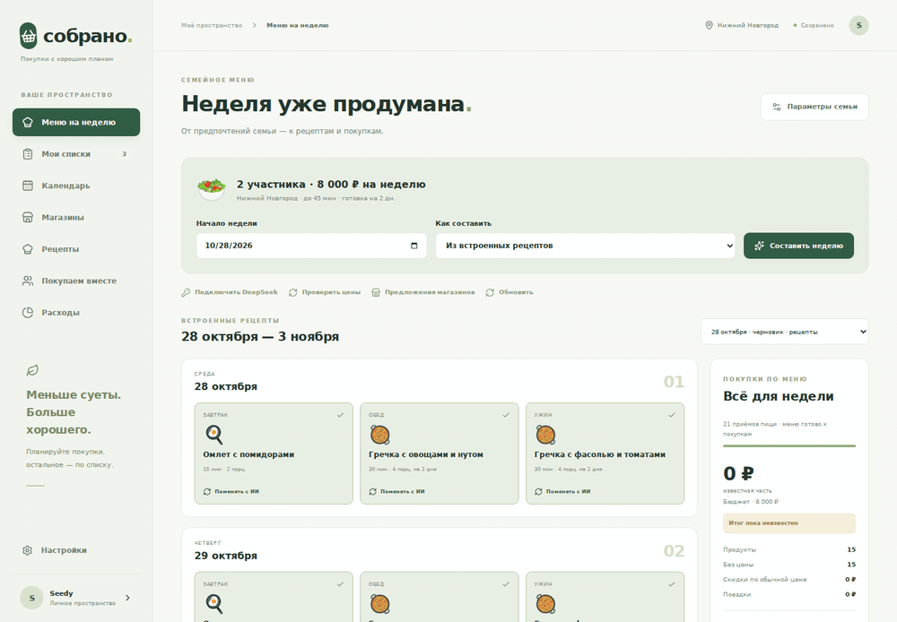
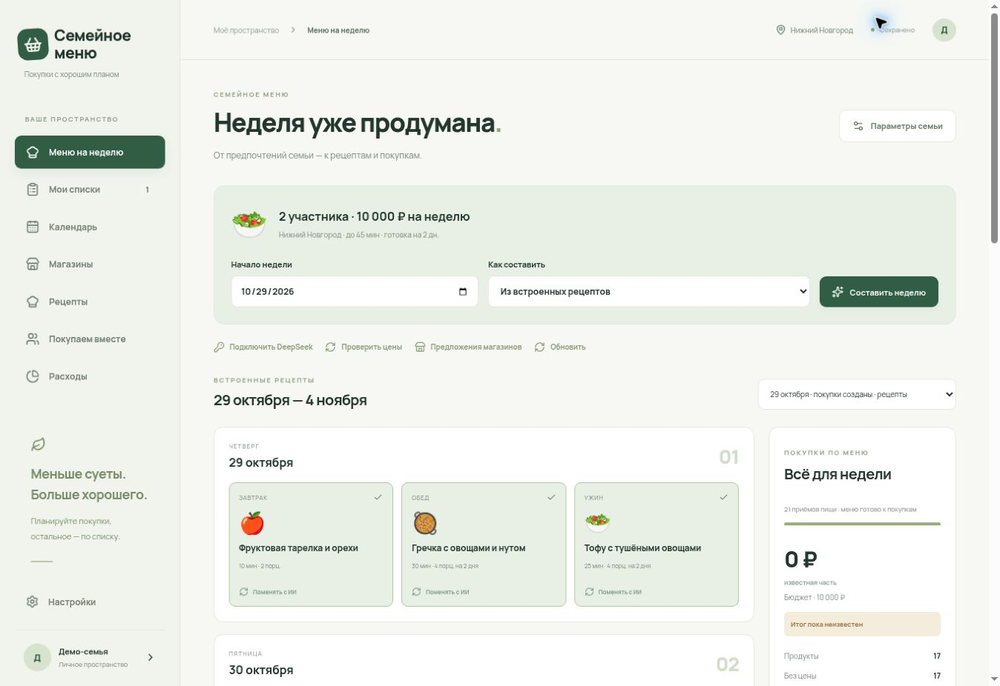
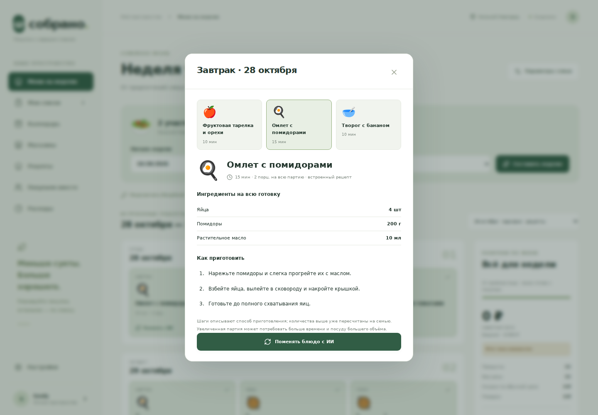
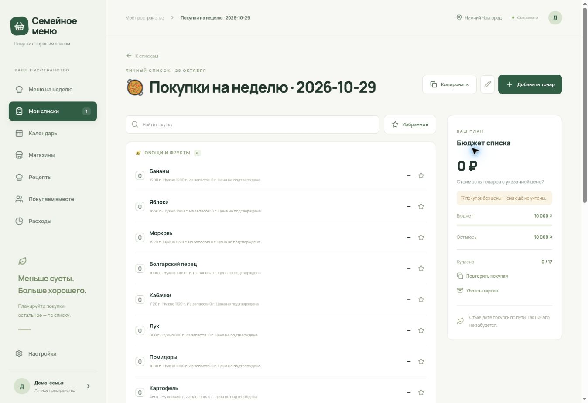
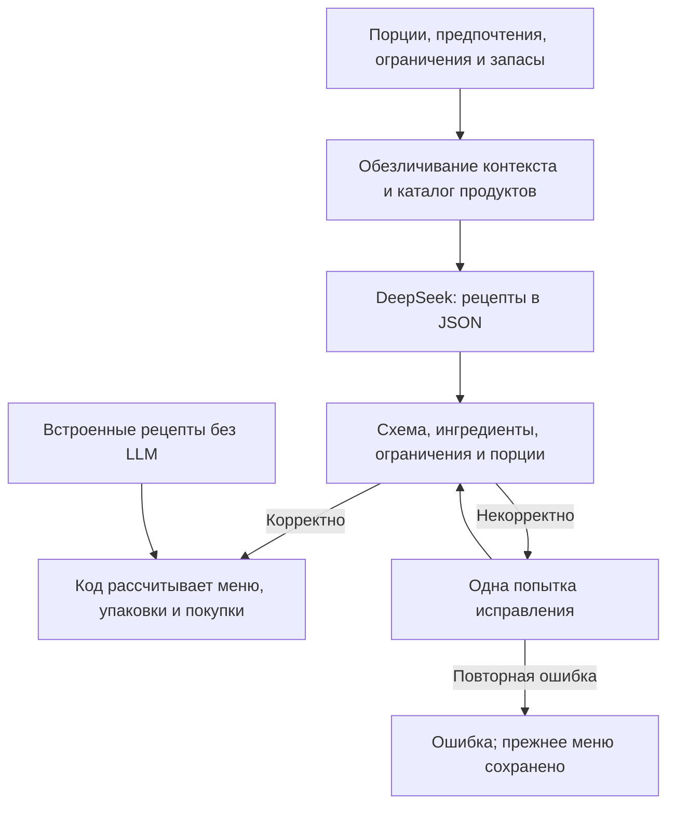

# family_menu — семейное меню и покупки с ИИ

Приложение для недельного меню, рецептов, домашних запасов и списков покупок. Сопоставляет ингредиенты с доступными предложениями магазинов Нижнего Новгорода.

**Статус:** личный прототип/PWA. Коммерческие внедрения и измеренная экономия не заявляются. Автор — [Евгений Смирнов](https://github.com/trollpom), B2B-продакт. Фокус — веб-разработка, прикладной ИИ и автоматизация; проект создан с помощью ИИ и AI coding tools.


## Демонстрация для жюри

Проект переименован в `family_menu`. Ниже сохранены реальные снимки интерфейса до переименования: на них видно прежнее название «Собрано». Функции на снимках не изменялись при смене названия.

Реальный интерфейс приложения на локальной тестовой базе, только вымышленная семья и встроенные рецепты. Платные запросы не выполнялись. Цены магазинов не подменялись демонстрационными: отсутствующие цены остаются неизвестными. Снимки от 28.10.2026.



GIF — последовательность трёх экранов основного сценария; это не запись живого запроса к LLM.

| Меню на неделю | Рецепт и порции |
| --- | --- |
|  |  |



## Где работает ИИ



LLM предлагает рецепты; суммы, упаковки, сопоставление с запасами и доступными ценами рассчитывает код. Скриншоты показывают ветку встроенных рецептов, а не результат живого запроса DeepSeek. Медицинские ограничения требуют проверки специалистом.


## Возможности

- Параметры семьи, порции, предпочтения, ограничения, бюджет и магазины.
- Меню из встроенных рецептов либо рецептов, предложенных DeepSeek.
- Замена блюда с пересчётом покупок и учётом запасов.
- Сравнение целых упаковок по доступным ценам; неизвестная цена остаётся неизвестной.
- Сохранение списков и рецептов, отметки покупок и PWA-интерфейс.

LLM предлагает рецепты. Проверка ответа, расчёты порций, запасов и упаковок выполняются кодом. Ошибка генерации сохраняет прежнее блюдо. Платная генерация требует собственного ключа провайдера; встроенные рецепты доступны без него.

## Технологии

TypeScript · React · Next.js/Vinext · Tailwind CSS · Drizzle ORM · SQLite/D1 · DeepSeek API · Netlify Blobs.

## Подготовка и запуск

Нужны Node.js 22.13+ и pnpm 11.25.0 из `packageManager`. Штатный установщик использует Bash и утилиты Linux; на Windows подходит WSL.

```bash
git clone https://github.com/trollpom/family_menu.git
cd family_menu
npm run install:ci
npm run dev
```

Основная сборка: `npm run build`. Для Next.js/Netlify используются отдельные команды `npm run dev:netlify` и `npm run build:netlify`; инструкция уже находится в [docs/netlify.md](docs/netlify.md). Приложению нужен настроенный серверный контекст: один запуск localhost не создаёт готовую общую демоверсию. Рабочие данные и секреты для проверки кода не нужны.

## Проверки без действующих ключей

```bash
node node_modules/typescript/bin/tsc --noEmit
node tests/checks.mjs
node tests/planner-checks.mjs
node tests/planner-service-checks.mjs
node tests/deepseek-recipes-checks.mjs
node tests/catalog-prices-checks.mjs
node tests/auth-checks.mjs
node tests/netlify-checks.mjs
```

Тесты работают с фикстурами, тестовыми базами и подставными ответами провайдера. Проверяются расчёты, валидация рецептов, ошибки, доступ и конфликты записей.

**27.10.2026:** успешно выполнены установщик, 13 проверочных сценариев без HTTP-теста, проверка типов и production-сборка Netlify. Это не проверка актуальности магазинных цен или конкретной рабочей установки. Живые платные запросы не выполнялись.

## Как показать проект

Вымышленная семья → меню → замена блюда → пересчёт покупок → продукты без найденной цены. Поясните, какую часть делает модель, а какую — код. Скриншоты с личными сведениями и ключами для портфолио не используются.

## Ограничения

Полный актуальный ассортимент всех сетей не гарантируется. Есть загрузчики SPAR, Магнита и Смарта; их доступность зависит от источника и региона. Официальные полные каталоги Пятёрочки и Чижика не подтверждены как подключённые. Расчёт бюджета ориентировочный; глобальный минимум стоимости не гарантируется.

Нет подписанных Android/iOS-сборок и коммерческих платежей: `mobile/` содержит каркас. Сервис не назначает лечебное питание. Для демонстрации используйте вымышленные сведения и собственные тестовые настройки.

Основные модули: `app/weekly-planner.tsx` — интерфейс; `lib/planner-service.ts` — сценарии; `lib/deepseek.ts` — модель; `lib/catalog-prices.ts` — расчёты; `db/schema.ts` — схема. Правила разработки: [AGENTS.md](AGENTS.md).
